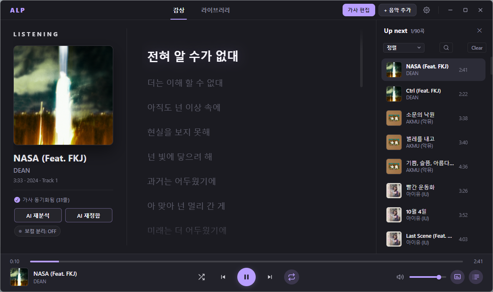

# ALP — Auto Lyrics Player

<p align="center">
  
</p>

**ALP (Auto Lyrics Player)**는 로컬 음원을 감상하면서 오프라인 Whisper 및 Gemini AI 음성 분석·정밀 정합 기술을 통해 실시간 동기화 가사를 자동 생성하고, 투명 플로팅 가사창과 전용 편집기까지 제공하는 데스크톱 뮤직 플레이어입니다.

---

## 주요 기능

### 1. 하이브리드 AI 음성 분석 (STT) 및 보컬 분리 전처리
- **로컬 Faster-Whisper 엔진**: 오프라인 환경에서도 로컬 Whisper 모델(`transcribe.py` / `transcribe.exe`)로 음원을 분석하여 타임스탬프 가사를 추출합니다.
- **경량 ONNX 보컬 분리 전처리**: `UVR-MDX-NET-Voc_FT` 모델과 `onnxruntime-directml` 기반 GPU/CPU 자동 가속으로 MR/반주 노이즈를 제거한 뒤 전사 정확도를 높일 수 있습니다.
- **클라우드 Gemini 엔진**: Google Gemini 모델(`gemini-3.5-flash-lite`, `gemini-3.1-flash-lite`, `gemini-3.8-flash`) 연동을 지원하며, `503`/`429` 일시적 과부하 시 멀티 모델 자동 폴백으로 끊김 없이 분석합니다.
- **내장 태그·로컬 가사 우선 로드**: 음원 파일 메타데이터에 포함된 가사나 같은 폴더의 `.lrc` / `.vtt` 파일이 있으면 AI 연산 없이 즉시 표시합니다.

### 2. Gemini 기반 정밀 AI 정합 및 자동화 워크플로우
- **정밀 가사 정합 (`AI 정합`)**: 외부 가사(LRCLIB 다국어 유사도 자동 검색) 또는 사용자가 입력한 공식 가사와 AI 음성 인식 타임라인을 대조해, 누락이나 오인식 없이 곡 박자에 맞는 싱크 가사를 완성합니다.
- **3단계 자동화 워크플로우**: `설정 > AI 및 음성 분석`에서 곡 재생 시 동작을 **수동**, **AI 분석만**, **AI 분석 + AI 정합 자동 실행** 중 원하는 흐름으로 설정할 수 있습니다.
- **다음 곡 백그라운드 프리페치**: 재생 목록 및 비반복 셔플 덱 기준 다음 곡의 가사/분석 결과를 백그라운드에서 미리 준비하고, 재생 중인 트랙과 분리된 작업 격리로 곡 전환 중에도 결과가 섞이지 않습니다.

### 3. 온디맨드 AI 모델 및 GPU 가속 팩 (CUDA) 관리
- **경량 기본 설치**: 대용량 모델과 CUDA DLL을 기본 설치 파일에서 분리해 배포 용량을 최소화했습니다.
- **원클릭 설치·취소·삭제**: 설정 창에서 Whisper 모델, 보컬 분리 모델, NVIDIA GPU 가속 팩(`CUDA`)을 필요할 때만 다운로드하거나 삭제할 수 있으며, 다운로드 중 취소도 지원합니다.
- **런타임 안전 Fallback**: CUDA DLL이 없거나 GPU 초기화에 실패해도 중단되지 않고 CPU(`int8`) 모드로 자동 전환됩니다.

### 4. 음악 감상 중심 UI · 듀얼 테마 & 투명 플로팅 가사창
- **3뷰 워크스페이스 & 도킹 대기열**: 오픈 캔버스 **감상** 화면, 테이블 기반 **라이브러리** 화면, 우측 분할 도킹 **대기열 (`Up next`)**, 대칭형 하단 플레이어 바를 제공합니다.
- **듀얼 테마**: `Lyra Lavender`(기본)와 `Emerald Dark` 두 가지 테마를 실시간 전환할 수 있습니다.
- **데스크톱 투명 플로팅 가사창**: 다른 작업 중에도 항상 위에 띄워두는 투명 가사창을 제공하며, 마우스 관통 잠금 모드·글자 크기·투명도·글자 색상·정렬 방향을 자유롭게 조정할 수 있습니다.

### 5. 전용 가사 편집기 및 음원 태그 내장 (Embed)
- **전용 가사 편집 화면 (`가사 편집`)**: 줄별 타임스탬프·가사 직접 수정, `±0.1s` / `±0.5s` 전체 싱크 오프셋 조절, `.lrc` / `.vtt` 내보내기를 지원합니다.
- **음원 파일 직접 저장 (Embed)**: 완성된 싱크 가사를 MP3, FLAC, M4A 등 음원 파일 메타데이터 태그에 직접 기록합니다.
- **트랙별 캐시 관리**: 곡 단위로 캐시된 가사를 초기화하고 언제든 재분석할 수 있습니다.

---

## 설치 및 실행 방법

### 일반 사용자 (Windows 설치 파일)
1. **[GitHub Releases](https://github.com/chaanheeLEE/AutoLyricsMusicPlayer/releases)** 페이지로 이동합니다.
2. 최신 버전(`v1.1.0` 이상)의 **`AutoLyricsPlayer Setup <version>.exe`** 설치 파일을 다운로드하여 실행합니다.
3. 별도의 Python이나 FFmpeg 수동 설치 없이 바로 사용할 수 있습니다. (NVIDIA GPU 가속이 필요하면 앱 내 설정 또는 릴리즈의 `cuda-runtime-win64.zip`을 활용할 수 있습니다.)

### 개발자 환경 (소스 코드 실행 및 빌드)

```bash
# 1. 저장소 클론
git clone https://github.com/chaanheeLEE/AutoLyricsMusicPlayer.git
cd AutoLyricsMusicPlayer

# 2. 의존성 패키지 설치
npm install

# 3. 앱 실행 / 개발자 도구 포함 실행
npm start
npm run dev

# 4. 정적 구문 검사 및 단위 테스트
npm run check
npm test

# 5. 프로덕션 빌드 (바이너리 준비 + Windows 설치 파일 생성)
npm run build
```

---

## 권장 환경 및 설정 가이드

### 1. Gemini API 키 연동 (선택 사항, 권장)
- 상단 우측 **설정 > AI 및 음성 분석** 탭에서 Google AI Studio에서 발급받은 Gemini API Key를 입력합니다.
- 클라우드 기반 고속 음성 인식 및 **AI 정합** 기능을 사용할 수 있습니다.
- 모델 선택에서 `gemini-3.5-flash-lite`(기본값, 빠른 속도), `gemini-3.1-flash-lite`(최신 경량), `gemini-3.8-flash`(고정밀)를 선택할 수 있으며, 응답 지연/과부하 시 다른 모델로 자동 폴백됩니다.

### 2. NVIDIA GPU 가속 및 보컬 분리 활용
- NVIDIA GPU가 장착된 PC에서는 **설정 > AI 및 음성 분석**에서 **CUDA 가속 팩**을 설치하면 로컬 Whisper 전사 속도가 크게 향상됩니다.
- 반주음이 커서 가사 인식이 흔들리는 곡은 같은 설정 탭에서 **보컬 분리 전처리**를 켜고 온디맨드 ONNX 모델을 설치해 정확도를 개선할 수 있습니다.

---

## 문서 및 변경 이력
- 버전별 변경 이력: [CHANGELOG.md](CHANGELOG.md)
- 향후 개발 및 개선 로드맵: [docs/todo.md](docs/todo.md)
